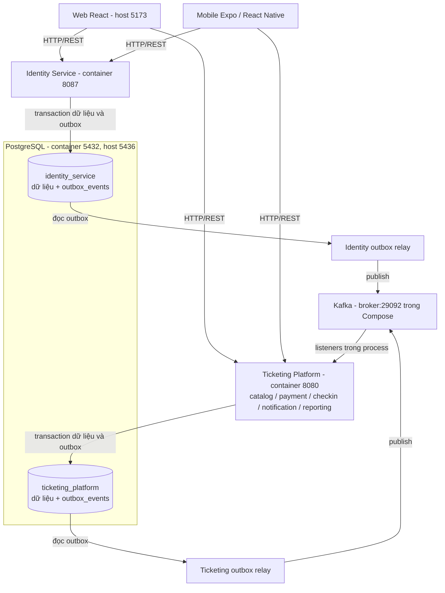

# Kiến Trúc Hệ Thống

## Tổng quan

Hệ thống có hai ứng dụng backend Spring Boot: **Identity Service** và
**Ticketing Platform**. Ticketing Platform là một **modular monolith**: các module
`catalog`, `payment`, `checkin`, `notification` và `reporting` chạy cùng process,
chia sẻ database `ticketing_platform`. Identity Service có database
`identity_service` riêng. Hai database nằm trong cùng container PostgreSQL 16,
với role truy cập riêng cho mỗi ứng dụng.

Client gồm web **React + Vite + Tailwind CSS** (`frontend/`) và mobile
**Expo/React Native + Expo Router + TypeScript** (`mobile/`). Client gọi HTTP/REST;
Kafka phục vụ các luồng bất đồng bộ giữa backend và giữa các module.



Relay là thành phần bên trong ứng dụng tương ứng, không phải service triển khai
riêng. Backend kết nối trực tiếp database của mình; Kafka không đứng giữa backend
và PostgreSQL. Trong Compose, Nginx phục vụ web và proxy `/api/user` tới Identity,
`/api/` còn lại tới Ticketing Platform; `/.well-known/jwks.json` trên web proxy tới
khóa ký QR của Ticketing Platform. Khi phát triển, client có thể gọi trực tiếp
backend theo cấu hình URL.

### Cổng theo Docker Compose

| Thành phần | Host → container | Ghi chú |
|---|---|---|
| Web frontend | `5173 → 8080` | Nginx; Vite dev cũng dùng 5173 theo hướng dẫn setup |
| Identity Service | `8087 → 8087` | JWT và tài khoản |
| Ticketing Platform | `8091 → 8080` | Chạy ngoài Docker mặc định 8091 |
| PostgreSQL | `127.0.0.1:5436 → 5432` | Hai database, hai role ứng dụng |
| Kafka | `127.0.0.1:9092 → 9092`, `127.0.0.1:29092 → 29092` | Host dùng `localhost:9092`; backend Compose dùng `broker:29092` |
| Zookeeper | `127.0.0.1:2181 → 2181` | Hạ tầng Kafka |
| Kafka UI | `127.0.0.1:8086 → 8080` | Quan sát topics và consumers |

Mobile chạy riêng qua Expo, không có service/cổng mobile cố định trong Compose.
Nguồn cấu hình: [docker-compose.yml](../docker-compose.yml).

## Trách nhiệm các thành phần

- **Identity Service:** đăng ký, đăng nhập, refresh token, xác minh email, đặt lại
  mật khẩu, quản lý người dùng và role; phát JWT và cung cấp JWKS.
- **Catalog:** sự kiện, loại vé, quota, coupon/bundle, giữ chỗ, phát hành và ký QR,
  khách mời, chuyển nhượng/thu hồi vé, danh sách chờ.
- **Payment:** tạo payment request từ giá reservation trên server; Mock hoặc
  VNPay, xác minh kết quả, đối soát và hoàn tiền.
- **Checkin:** thiết bị và API key, xác minh QR, ghi nhận lần quét, giới hạn lượt
  vào, thống kê và timeline check-in. Việc ký QR thuộc Catalog.
- **Notification:** nhận sự kiện để gửi email xác minh/đặt lại mật khẩu, vé kèm
  ảnh QR, thay đổi trạng thái vé và lời mời từ danh sách chờ.
- **Reporting:** báo cáo sự kiện, xuất CSV người tham dự/thanh toán và analytics
  lượt xem. Đọc database chung, không phải service/database riêng.

## Giữ chỗ, thanh toán và phát hành vé

```text
POST /api/ticket-types/{ticketTypeId}/reservations
  → vé RESERVED, reservationId, thời hạn giữ chỗ; chưa ký QR
POST /api/payment/requests { reservationId }
  → kết quả Mock hoặc PENDING + paymentUrl của VNPay
  → payment-completed (qua transactional outbox và Kafka)
  → Catalog: RESERVED → ISSUED, ký QR
  → ticket-issued (qua transactional outbox và Kafka)
  → Notification: gửi email kèm ảnh QR
```

### Giữ chỗ và hết hạn

Người mua dùng JWT; mặc định email phải được xác minh để đặt chỗ. Sự kiện phải
`PUBLISHED`, chưa kết thúc và trong khung mở bán nếu đã cấu hình. Catalog khóa dòng
loại vé khi kiểm tra `issued_count + reserved_count` với quota, lưu vé `RESERVED`
và `ticket-reserved` trong cùng transaction. Giá sau coupon/bundle được chốt trên
`tickets.price_cents`; Payment tính số tiền từ các vé đang giữ, không lấy giá do
client gửi.

Thời hạn giữ chỗ mặc định 10 phút (`ticketing.reservation.expiry-minutes`).
`ExpireReservationsJob` chạy mỗi 60 giây, hủy reservation quá hạn và trả quota
cùng lượt dùng coupon. Job bỏ qua reservation có payment `PENDING`: kết quả đối
soát thanh toán sẽ quyết định xác nhận hoặc hủy. `payment-failed` cũng kích hoạt
hủy các vé còn `RESERVED` và giải phóng quota.

### Mock và đơn miễn phí

`ticketing.payment.provider=mock` là mặc định. Mock trả `COMPLETED` hoặc `FAILED`
ngay trong request, lưu payment và sự kiện kết quả vào outbox trong transaction.
Phát hành vé vẫn bất đồng bộ qua Kafka, nên payment thành công chưa có nghĩa QR
đã xuất hiện ngay trong response. Đơn tổng tiền 0 được hoàn tất với provider
`FREE`, không gọi cổng thanh toán nhưng vẫn phát `payment-completed`.

Tạo payment kiểm tra chủ reservation trước cả khi trả lại payment đã có; request
lặp cho cùng reservation trả lại bản ghi hiện có. Giá và hạn reservation được
kiểm tra trước khi tạo payment mới.

### VNPay và đối soát

`ticketing.payment.provider=vnpay` tạo payment `PENDING` và URL thanh toán ký
HMAC-SHA512; hạn thanh toán lấy từ reservation. Backend xác định kết quả qua:

1. `GET /api/payment/vnpay/ipn`: xác minh chữ ký callback, mã giao dịch và số tiền.
2. `POST /api/payment/vnpay/sync/{txnRef}`: kiểm tra chủ reservation rồi gọi
   `querydr` tới VNPay, kiểm chữ ký response; không dùng query string từ trình
   duyệt làm bằng chứng đã trả tiền.
3. `PaymentReconciliationJob`: mặc định mỗi 60 giây, hỏi lại payment `PENDING`
   đã tạo hơn 90 giây hoặc đã quá hạn thanh toán cộng 120 giây grace period.

Kết quả thành công phải khớp số tiền. Nếu provider chưa truy cập được, giữ
`PENDING` để thử lại. Khi truy vấn được nhưng vẫn pending/không có giao dịch sau
hạn cộng grace period, job chuyển sang thất bại. Cập nhật có điều kiện
`saveIfPending` quyết định bên thắng khi IPN, sync và job chạy đồng thời; chỉ bên
chuyển trạng thái thành công mới ghi sự kiện kết quả vào outbox, cùng transaction.

Thành công và reservation còn giữ → `COMPLETED` + `payment-completed`; thất bại →
`FAILED` + `payment-failed`. Nếu đã trả tiền nhưng reservation không còn giữ,
payment thành `REFUND_REQUIRED` để job thử hoàn tiền, không phát hành vé.
Hoàn tiền VNPay do ADMIN yêu cầu cho payment `COMPLETED` phát `payment-refunded`;
Catalog cập nhật vé và phát `ticket-voided` để vô hiệu QR.

## Kafka và transactional outbox

Mỗi backend có `outbox_events` trong database của mình. Transaction nghiệp vụ ghi
dữ liệu và outbox cùng nhau. Relay đọc dòng chưa có `published_at`, gửi JSON lên
Kafka rồi đánh dấu đã gửi; lỗi publish giữ dòng để lần poll sau thử lại.
Relay poll mỗi 2 giây. Nếu Kafka đã nhận nhưng transaction đánh dấu chưa commit,
sự kiện có thể được gửi lại: đây là **at-least-once delivery**, không bảo đảm
exactly-once cho toàn bộ luồng.

Tên topic mặc định dưới đây khớp `application.properties` và các listener hiện tại:

| Topic | Producer | Consumer trong Ticketing Platform |
|---|---|---|
| `email-verification-requested` | Identity | Notification gửi link xác minh |
| `password-reset-requested` | Identity | Notification gửi link đặt lại mật khẩu |
| `ticket-reserved` | Catalog | Chưa có listener nghiệp vụ trong mã hiện tại |
| `payment-completed` | Payment | Catalog xác nhận reservation, ký QR và phát hành vé |
| `payment-failed` | Payment | Catalog hủy reservation |
| `payment-refunded` | Payment | Catalog xử lý vé được hoàn tiền |
| `ticket-issued` | Catalog | Notification gửi vé |
| `ticket-voided` | Catalog | Checkin cập nhật vé vô hiệu; Notification gửi thông báo |
| `ticket-resend-requested` | Catalog | Notification gửi lại vé |
| `waitlist-offered` | Catalog | Notification gửi lời mời thanh toán |

Identity chỉ publish, không có Kafka consumer. Các group
`ticketing-platform-catalog`, `ticketing-platform-checkin` và
`ticketing-platform-notification` tách nhau, nên Checkin và Notification đều nhận
`ticket-voided`. Các module trong monolith vẫn dùng Kafka cho các luồng trên.

Catalog confirm/cancel bỏ qua vé không còn `RESERVED` khi nhận lại sự kiện.
Consumer error handler retry với exponential backoff rồi chuyển lỗi chưa xử lý
được sang `<topic>.DLT`. Không có cơ chế dedup bền vững cho mọi tác dụng phụ:
Notification có thể gửi email lặp khi nhận lại sự kiện; lỗi gửi SMTP được bắt và
ghi log trong service thông báo, không tự động được Kafka retry chỉ vì gửi mail
thất bại.

## Xác thực, QR và check-in offline

### Hai miền khóa riêng

- **JWT tài khoản:** Identity ký bằng RSA; Ticketing Platform lấy public key từ
  `http://identity-service:8087/.well-known/jwks.json` trong Compose. Role `ADMIN`
  và `ORGANIZER` cùng kiểm tra quyền trên từng sự kiện bảo vệ các API quản lý;
  người mua được kiểm tra quyền sở hữu reservation/vé.
- **QR vé:** Catalog dùng khóa RSA riêng, độc lập khóa JWT của Identity. Payload
  có dạng `kid.base64url(json).base64url(signature)` với chữ ký SHA256withRSA,
  gồm định danh vé/sự kiện/loại vé, khung hiệu lực và số lượt vào. Ticketing
  Platform cung cấp public key ở `/.well-known/jwks.json` cho client check-in;
  server xác minh bằng key provider trong cùng process. Compose giữ khóa hai
  ứng dụng trên hai volume riêng để tái sử dụng sau restart.

### Thiết bị và hàng đợi đồng bộ

Thiết bị đăng ký qua `POST /api/checkin/devices`; API key chỉ trả một lần và server
lưu hash. API nhận lượt quét (`POST /api/checkin`, `POST /api/checkin/batch`) dùng
header `X-Device-Key`, không dùng JWT người mua làm thông tin xác thực thiết bị.
Organizer chỉ quản lý thiết bị/sự kiện của mình; ADMIN có thể tạo thiết bị không
giới hạn một sự kiện.

Web lưu lượt quét và chứng thư JWKS trong IndexedDB; mobile native dùng SQLite.
Client lưu lượt quét với `idempotencyKey`, QR và `clientCheckinAt` **trước** khi gửi.
Khi offline, client dùng public key đã cache để kiểm tra chữ ký, khung hợp lệ,
sự kiện và lịch sử lượt vào trên máy. Chưa có chứng thư thì không thể xác nhận
chữ ký offline. Hàng đợi còn pending được gửi tới `/api/checkin/batch` theo lô tối
đa 100 khi đồng bộ; lỗi mạng hoặc phản hồi không đầy đủ giữ lượt quét để thử lại.

Kết quả offline là tạm thời: thiết bị không biết ngay lượt quét trên máy khác
hoặc việc thu hồi vé/thiết bị vừa xảy ra. Server kiểm tra lại thiết bị, chữ ký,
sự kiện, khung hiệu lực theo thời điểm server nhận và trạng thái vô hiệu của vé.
Vì vậy lượt quét offline đồng bộ sau khi hết khung có thể bị `EXPIRED_WINDOW`.

### Giới hạn lượt vào và audit

Server trả lại bản ghi đã có khi nhận lại `idempotencyKey`. Với lượt quét hợp lệ,
PostgreSQL advisory lock theo vé bảo vệ bước kiểm tra `voided_tickets`, đếm lượt
`ACCEPTED` và insert trong cùng transaction. Unique index trên
`(ticket_id, entry_no)` cho các dòng `ACCEPTED` bổ sung bảo vệ ở database.
`maxEntries` được ký trong QR (claim `me`, mặc định 1); dùng hết lượt trả
`DUPLICATE`. Chuyển nhượng dùng cùng khóa theo vé để từ chối chuyển vé đã sử dụng
và ghi vé cũ vào `voided_tickets` ngay trong transaction. Thu hồi/hoàn tiền cập
nhật danh sách vé vô hiệu qua listener `ticket-voided`, nên có độ trễ bất đồng bộ.

Nếu hai thiết bị offline quét cùng vé, thứ tự server xử lý/commit khi đồng bộ
quyết định lượt được chấp nhận, không phải timestamp do thiết bị khai. Các kết
quả được ghi vào `checkin_records`: `ACCEPTED`, `DUPLICATE`, `INVALID_SIGNATURE`,
`WRONG_EVENT`, `EXPIRED_WINDOW`, `TICKET_VOIDED`, `DEVICE_NOT_FOUND`,
`DEVICE_REVOKED`. Client timestamp phục vụ lịch sử/timeline, không quyết định
quyền vào cổng.

## Database và migrations

Flyway quản lý schema riêng cho từng backend tại `src/main/resources/db/migration/`.
Các bảng ứng dụng hiện có theo migrations:

| Database | Bảng | Vai trò |
|---|---|---|
| `identity_service` | `users`, `user_roles` | Tài khoản và role; không có bảng `roles` riêng |
| `identity_service` | `refresh_tokens`, `user_tokens` | Phiên refresh, token xác minh email/đặt lại mật khẩu |
| `identity_service` | `outbox_events` | Sự kiện Identity chờ gửi Kafka |
| `ticketing_platform` | `events`, `ticket_types`, `tickets` | Sự kiện, quota, giữ chỗ và vé |
| `ticketing_platform` | `coupons`, `waitlist_entries` | Giảm giá và danh sách chờ |
| `ticketing_platform` | `payment_requests` | Payment, trạng thái provider và hoàn tiền |
| `ticketing_platform` | `checkin_devices`, `checkin_records`, `voided_tickets` | Thiết bị, audit lượt quét và vé vô hiệu |
| `ticketing_platform` | `event_images`, `event_views` | Ảnh sự kiện và dữ liệu lượt xem |
| `ticketing_platform` | `outbox_events` | Outbox dùng chung các module |

Reservation được biểu diễn qua các vé có chung `reservation_id`, trạng thái và
thời hạn giữ chỗ; không có bảng reservation riêng. Reporting đọc các bảng hiện
có, không có database báo cáo riêng.

## Quan sát và tài liệu liên quan

Actuator mặc định expose `health,info`; Compose kiểm tra backend qua
`/actuator/health/liveness`. Kafka UI hỗ trợ xem topics/consumer; outbox chưa gửi
và `checkin_records` hỗ trợ theo dõi xử lý bất đồng bộ và audit.

- [API Identity Service](api/identily-service.md)
- [API Ticketing Platform](api/ticketing-platform.md)
- [Database](database.md) và [migrate PostgreSQL hiện có](postgres-migration.md)
- [Luồng nghiệp vụ](business-flows.md)
- [Setup và vận hành local](setup.md)
- [Kiểm tra thanh toán và check-in](payment-checkin-testing.md)
